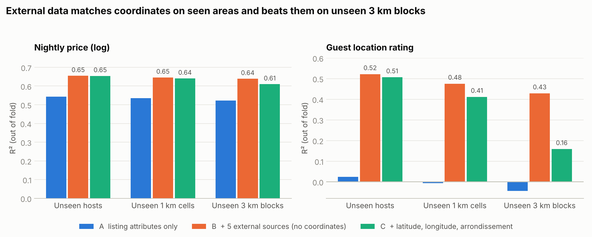

# Paris Airbnb 多源数据项目：任务设计、数据与后续计划

D4E Data Science Project · 2026 年 11 月 12 日 · 代码见 `notebooks/`，结果见 `results/`

## 1. 一句话

把五个公开的外部数据源按坐标拼到巴黎 Airbnb 房源上，检验它们能否改善**每晚标价**的预测。结果：R² 从 0.54 升到 0.65，每晚误差少 11 欧；在没见过的区域，外部数据比经纬度更准。

## 2. 任务设计

### 2.1 为什么是这个任务

课程要求是一个监督学习问题，用开放的多来源数据，并且**合并外部数据要带来真实的性能提升**。

最初设想的目标是房东收入，但被放弃了，原因有两个：

- **收入没有真实标签。** Inside Airbnb 的收入是由评论数推算的（评论数 ÷ 评论率 × 平均入住晚数 × 标价）。评论率 50% 和每次入住 5.2 晚这两个假设无法验证，换一组假设，收入中位数相差 3 倍以上。
- **地段对订单没有直接作用。** 7 个订单类目标上，外部数据和经纬度的增益都是 0（见 4.3）。主任务选在一个"外部数据确实有用"的目标上，否则无法满足课程要求。

最终的设计：

| 角色 | 任务 | 类型 | 目标变量 | 为什么 |
| --- | --- | --- | --- | --- |
| **主任务** | 每晚标价 | 回归 | log(挂牌价，欧元) | 真实观测值；房东定价时会考虑地段，而房源自身特征里没有地段信息 |
| 副任务 | 住客位置评分 | 回归 | `review_scores_location` | 几乎完全由地理决定，用来检验"没有外部数据模型就失效" |
| 负结果 | 7 个订单类目标 | 回归、分类 | 7 月评论数、新房源首单、下架、超赞转化、估算入住与收入 | 说明为什么不选它们作主任务 |
| 延伸 | 定价溢价 → 订单 | 两阶段 | 第一阶段：合理价格；第二阶段：7 月评论数 | 把价格与订单连起来：地段通过价格间接影响订单 |

### 2.2 核心对比：怎样才算"外部数据有用"

同一个梯度提升模型，只换特征组：

| 组 | 特征 | 数量 |
| --- | --- | --- |
| A | 房源自身：容量、卧室、床、卫生间、最少入住、设施、房型、报价的入住月份、提前天数与入住晚数 | 16 |
| A + 单一来源 | A 加一个外部来源 | 22–45 |
| **B** | A + 五个外部来源，**不给经纬度和行政区** | 78 |
| B − 单一来源 | 从 B 中去掉一个来源 | — |
| C | A + 经纬度 + 行政区（"位置信息"的参照） | 19 |
| D | C + 五个外部来源 | 81 |

**多源增益 = B 相对 A 的提升。**

为什么 B 不给经纬度：经纬度本来就在 Airbnb 表里，不算外部数据。而且一旦模型有了经纬度，车站距离这类特征就只是坐标的另一种写法，不会再带来提升。组员早先的版本在经纬度之上加车站特征（即 C → D），所以测出 0。

### 2.3 评估方式

5 折分组交叉验证，三种分组方式：

| 名称 | 分组单位 | 检验什么 |
| --- | --- | --- |
| 未见房东 | 房东 ID | 同一房东的房源不会同时出现在训练集和测试集，避免成绩虚高 |
| 未见 1 公里格子 | 1 公里地图格子（120 个） | 能否预测没见过的位置 |
| 未见 3 公里区块 | 3 公里区块（21 个） | 能否迁移到一整片没见过的区域 |

- 后两种方式还会把测试折出现过的房东从训练集中剔除。
- 指标：回归用 R² 和欧元 MAE，计数用泊松偏差解释率 D²，分类用 AUC。
- 欧元误差的 95% 区间用聚类自助法计算（500 次），聚类单位与分组方式一致。
- 每个结论同时看各折结果：只有五折全部为正，才称为"稳定"。

## 3. 数据：选择、处理与检查

### 3.1 数据源

| 来源 | 发布方 | 选它的原因 | 拼接方式 | 规模 |
| --- | --- | --- | --- | --- |
| Inside Airbnb（主表） | Inside Airbnb | 公开的房源、价格、评论 | 房源 ID | 2026 年 9 月快照 77,149 条；6 月快照面板 |
| IDFM 车站 | 法兰西岛交通局 | 交通可达性 | 半径计数、最近距离 | 998 个站 |
| OpenStreetMap | OSM 社区 | 餐饮、夜生活、文化、景点、酒店、公园、日常商店 | 250/500/1000 米计数、最近距离、景点吸引力指数 | 31,926 个地点 |
| DVF | 法国财政部（Etalab） | 地段"值多少钱"的直接度量 | 周边公寓每平米成交价中位数 | 2022–2025 年，有效成交 112,640 笔 |
| IRIS 边界 + Filosofi 2021 | IGN、INSEE | 街区收入、贫困率、贫富差距 | 坐标落入 IRIS 多边形，再按 IRIS 代码连接收入表 | 992 个 IRIS |
| 治安统计 | 内政部 SSMSI | 安全感 | IRIS 所属的区 | 20 个区，6 类案件，2024 年 |

**没有选的数据**：
- 历史天气、节假日：只有日期维度，对截面价格没有区分度。
- 长租参考租金：可作为后续收益对比，不进模型。

### 3.2 主表处理

- 样本：整租房，最少入住少于 30 晚（30 晚以上属于中长租），挂牌价 20–1,000 欧。共 31,044 套。
- 清洗与特征由组员仓库（`2026_DS_Airbnb`）完成，本项目直接使用其中的 `price_features.csv.gz`，包括：
  - 价格解析；
  - 报价的入住日期与提前天数；
  - 设施计数；
  - 剔除归属多个房源的 42,347 条评论。

### 3.3 外部数据处理

- **OSM**：路径（way）和关系（relation）类要素取其中心点。同一地点可以同时属于两组，例如博物馆既算文化也算景点。
- **DVF**：一笔交易只报总价，所以只保留恰好包含一套公寓（可附带地下室或车位）的买卖，要求面积 ≥ 9 平米、每平米价格在 3,000–40,000 欧之间。
  - 原始记录 338,541 行，对应 163,622 笔交易，保留 112,640 笔。
  - 每平米价格中位数为 10,167 欧。
  - 附近成交少于 5 笔时，半径中位数记为缺失。
- **IRIS**：
  - 用 shapely 做点落入多边形的判断。有 5 套房源因坐标偏移落在边界外，按最近的多边形匹配。
  - INSEE 不公布部分商业区 IRIS 的收入（992 个中有 864 个公布），缺失值保留，由模型处理。
- **治安**：
  - 下载的全国文件按市镇代码列筛选出巴黎各区。早先的筛选在整行里找"75"，误纳入 17 行外省数据，已修正。
  - 取 2024 年每千人案件率。

### 3.4 拼接质量检查（notebook 01）

| 检查 | 结果 |
| --- | --- |
| 由 IRIS 推出的行政区与 Airbnb 自带的行政区一致 | 99.95% |
| 各来源的覆盖率 | 车站、OSM、治安 100%；DVF 99.3%；IRIS 收入 94.9% |
| 落在 IRIS 边界外的房源 | 5 套，就近匹配 |
| 数值范围 | 最近地铁站中位数 0.21 公里；1 区每千人盗窃 325 起（游客与通勤人口推高了人均值） |

### 3.5 防止信息泄漏

- DVF 截至 2025 年，治安数据取 2024 年，都早于 2026 年的快照。
- 订单类目标的特征全部取自 6 月快照，结果在之后观测。
- OSM 是 2026 年 11 月的版本，晚于快照，当作缓慢变化的街区属性处理。这是一个近似。
- 外部特征只使用 Airbnb 的坐标列，不使用其他任何 Airbnb 字段。
- 每次下载都记录了网址、日期和 SHA-256，见 `data/external/manifest.json`。

## 4. 结果摘要

### 4.1 主任务：每晚标价（R²）

| 特征组 | 未见房东 | 未见格子 | 未见区块 |
| --- | --- | --- | --- |
| A 房源自身 | 0.543 | 0.535 | 0.522 |
| A + IDFM 车站 | 0.613 | 0.587 | — |
| A + OSM | 0.650 | 0.632 | — |
| A + DVF | 0.648 | 0.640 | — |
| A + IRIS 收入 | 0.637 | 0.616 | — |
| A + 治安 | 0.633 | 0.619 | — |
| **B 全部外部** | **0.655** | **0.646** | **0.639** |
| C 经纬度 | 0.654 | 0.640 | 0.610 |

- **A → B，每晚误差下降**：
  - 未见房东：11.4 欧（95% 区间 10.6–12.1）；
  - 未见格子：11.0 欧（8.8–13.7）；
  - 未见区块：11.9 欧（8.6–16.5）。
  - 三种方式下各折全部为正。
- **未见区块上，B 的误差比 C 低 2.8 欧**（区间 0.4–4.6）。在见过的区域，两者持平。
- **去一来源**：去掉 DVF 或治安会让误差上升（区间不含 0），去掉其他来源没有影响。说明五个来源大量重叠，DVF 房价是最独特的信号。
- **两阶段残差**：外部数据解释约 21% 的地段溢价；在未见区块上，坐标只能解释 13%。



### 4.2 副任务：位置评分（R²）

| 特征组 | 未见房东 | 未见格子 | 未见区块 |
| --- | --- | --- | --- |
| A 房源自身 | 0.023 | −0.007 | −0.045 |
| B 全部外部 | 0.522 | 0.476 | 0.429 |
| C 经纬度 | 0.506 | 0.412 | 0.159 |

### 4.3 订单类目标：地段没有直接作用

7 个目标上，A、B、C 三组的差距都在 ±0.01 以内。例如：
- 7 月评论数 D²：0.633 / 0.630 / 0.631；
- 新房源首单 AUC：0.804 / 0.801 / 0.803。

### 4.4 延伸：定价溢价

7 月评论数的 D²：

| 特征 | D² |
| --- | --- |
| 历史 + 房源特征 | 0.472 |
| + 外部数据 | 0.469 |
| + 原始价格 | 0.483 |
| **+ 定价溢价** | **0.490** |

- 定价溢价相对原始价格的优势，在两种分组方式下都是五折全部为正。
- 这是预测上的相关关系，不是因果效应。

## 5. 局限

- 挂牌价不是成交价；9 月快照有 43.6% 的房源没有标价，样本存在选择。
- 区块留出只有 21 个区块，区间较宽；B 胜过 C 在五折中有一折不成立。
- 外部数据的年份与快照不完全同期；IRIS 收入是 2021 年；治安只到区一级。
- Airbnb 坐标有约 150 米的匿名化偏移，250 米半径的特征受影响最大。
- 超参数尚未调优，所有特征组共用同一套设置。

## 6. 后续任务设计

| 时间 | 任务 | 内容 | 负责 |
| --- | --- | --- | --- |
| 11 月 13 日 | 第一次汇报 | 5 分钟：问题、数据、A/B/C 设计、标价与位置评分结果、定价溢价 | 共同 |
| 11 月 14–22 日 | 合并代码 | 把本文件夹与组员仓库统一为一条流水线：同一份样本、同一份清洗、同一份环境文件 | 组员主导 |
| 11 月 14–22 日 | 稳健性 ① | 超参数调优，只在训练折内进行（嵌套交叉验证）；区块留出加 500 米缓冲带，剔除紧邻测试区块的训练样本 | Arthur |
| 11 月 23 日–12 月 6 日 | 稳健性 ② | 跨时间检验：用 6 月快照的标价训练、9 月快照测试，确认增益不只是截面现象 | 组员 |
| 11 月 23 日–12 月 6 日 | 解释 | SHAP：哪些外部特征推高或压低价格；误差分析：哪些区、哪类房源误差最大 | Arthur |
| 12 月 6 日 | **决策点** | 如果跨时间检验的增益明显缩小，报告结论限定为截面预测 | 共同 |
| 12 月 7–20 日 | 延伸深化 | 定价溢价的异质性：哪些区、哪类房源对溢价更敏感；新房源冷启动 | 共同 |
| 12 月 21 日–1 月 3 日 | 机动 | 报告初稿 | 共同 |
| 1 月 4–17 日 | 定稿 | 报告定稿；在干净环境中从零复现一遍 | 组员主导 |
| 1 月 18 日–月底 | 答辩 | 幻灯片；代码问答演练 | 共同 |

**交付物清单**：一条可复现的流水线（下载 → 特征 → 模型 → 图表）、报告、幻灯片、GitHub 仓库。

## 7. 文件结构

```
multisource_eval/
├── PROJECT_DESIGN.md                  本文件
├── README.md                          运行说明
├── requirements.txt
├── src/
│   ├── config.py                      数据路径（可用环境变量覆盖）
│   ├── common.py                      分组交叉验证、指标、车站特征
│   └── external.py                    五个外部来源的加载与特征构造
├── notebooks/
│   ├── 00_fetch_external_data.ipynb   下载外部数据（未执行，需在本地运行）
│   ├── 01_external_features_and_checks.ipynb
│   ├── 02_price_main_task.ipynb
│   ├── 03_location_rating.ipynb
│   ├── 04_demand_targets.ipynb
│   ├── 05_price_premium_extension.ipynb
│   └── 06_figures.ipynb
├── data/external/manifest.json        外部数据的网址、日期、校验码
└── results/                           结果表与图
```
